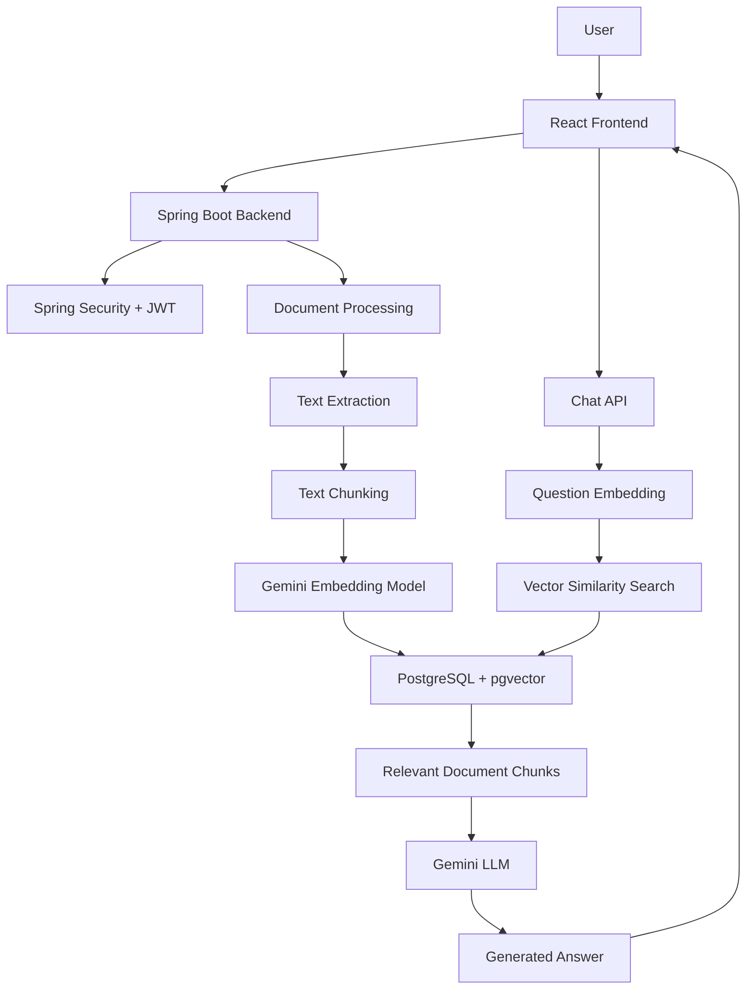
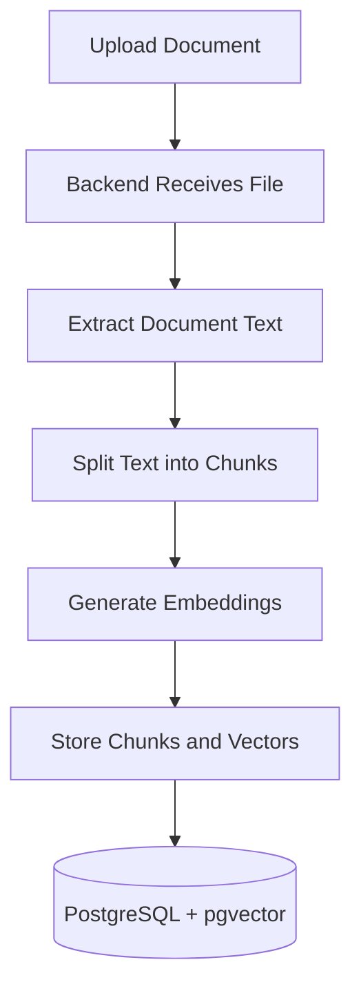
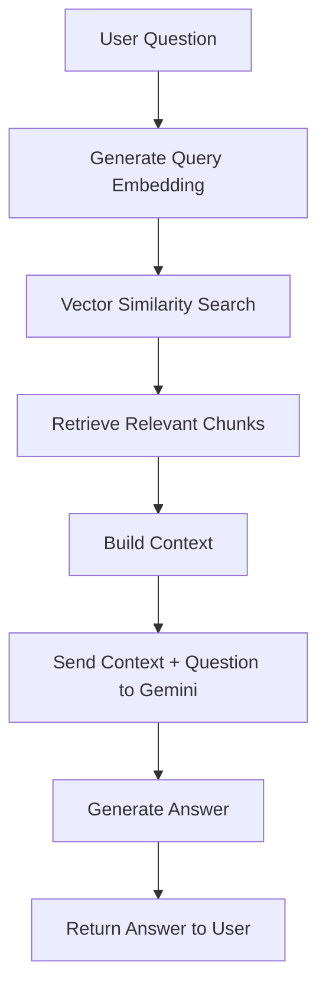
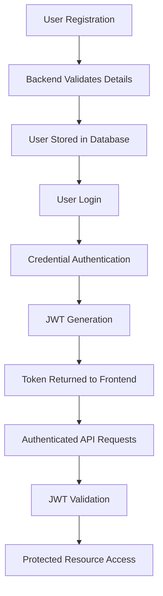

# DocMind — AI-Powered Document Intelligence & RAG System

DocMind is an AI-powered document intelligence platform that allows users to upload documents, process their content, and interact with them through natural language questions.

It uses **Retrieval-Augmented Generation (RAG)** to retrieve relevant information from uploaded documents and generate context-aware answers using Google Gemini.

The application combines a Spring Boot backend, React frontend, PostgreSQL with pgvector, and Google Gemini AI to provide an end-to-end document question-answering experience.

---

## 1. Key Features

- **User Authentication:** Secure registration and login using JWT-based authentication.
- **Document Upload:** Upload PDF and supported document files.
- **Document Processing:** Extract text from uploaded documents and divide it into smaller chunks.
- **Vector Embeddings:** Convert document chunks into numerical vector representations using Google Gemini embeddings.
- **Semantic Search:** Retrieve relevant document chunks using PostgreSQL and pgvector.
- **AI-Powered Question Answering:** Generate contextual answers using Google Gemini.
- **RAG Pipeline:** Ground AI responses in information retrieved from uploaded documents.
- **Vector Similarity Search:** Use cosine distance for finding semantically relevant content.
- **REST APIs:** Spring Boot-based backend APIs for authentication, document management, and chat operations.
- **Responsive Frontend:** React-based user interface.
- **Cloud Deployment:** Frontend hosted on Vercel and backend hosted on Render.

---

## 2. Technology Stack

### Backend

| Technology | Purpose |
|---|---|
| Java 25 | Core programming language |
| Spring Boot 4.1.1 | Backend application framework |
| Spring AI | AI model and vector store integration |
| Spring Security | Application security |
| JWT | Stateless authentication |
| Spring Data JPA | Database interaction |
| Maven | Dependency and build management |
| Docker | Backend containerization |

### Frontend

| Technology | Purpose |
|---|---|
| React | UI development |
| TypeScript | Type-safe JavaScript |
| Vite | Frontend build tool |
| Axios | HTTP communication |

### AI & RAG

| Technology | Purpose |
|---|---|
| Google Gemini | Large Language Model |
| Gemini 3.8 Flash | AI response generation |
| Gemini Embedding | Text embedding generation |
| Spring AI | Integration between application and AI models |
| RAG | Context-aware document question answering |

### Database & Infrastructure

| Technology | Purpose |
|---|---|
| PostgreSQL | Relational database |
| pgvector | Vector storage and similarity search |
| HNSW | Vector indexing |
| Cosine Distance | Similarity calculation |
| Prisma Postgres | Managed PostgreSQL hosting |
| Render | Backend deployment |
| Vercel | Frontend deployment |
| Git & GitHub | Version control and source management |

---

## 3. System Architecture



### Architecture Overview

1. Users interact with the React frontend.
2. The frontend communicates with Spring Boot REST APIs.
3. Spring Security validates authenticated requests using JWT.
4. Uploaded documents are processed by the backend.
5. Extracted text is divided into smaller chunks.
6. Google Gemini generates embeddings for these chunks.
7. Embeddings and associated document content are stored in PostgreSQL using pgvector.
8. When a user asks a question, the backend retrieves relevant chunks using vector similarity search.
9. Retrieved context is passed to Gemini.
10. Gemini generates an answer based on the retrieved document information.
11. The answer is returned to the frontend.

---

## 4. How RAG Works in DocMind

DocMind follows a Retrieval-Augmented Generation architecture.

RAG combines information retrieval with large language models to generate answers grounded in external data.

### A. Document Ingestion Pipeline

When a user uploads a document:



**Step-by-step process:**

1. The user uploads a document through the frontend.
2. The backend receives and processes the file.
3. Text is extracted from the document.
4. Extracted text is divided into smaller chunks.
5. Each chunk is converted into a vector embedding using Gemini.
6. The document content and embeddings are stored in the PostgreSQL vector store.

### B. Question Answering Pipeline

When a user asks a question:



**Step-by-step process:**

1. The user submits a natural language question.
2. The question is converted into an embedding.
3. The backend searches for semantically similar document chunks.
4. The most relevant chunks are retrieved.
5. The retrieved content is combined with the original question.
6. Gemini generates a context-aware answer.
7. The response is returned to the frontend.

This approach helps reduce dependence on the model's general knowledge by providing relevant document context.

---

## 5. Vector Database Configuration

DocMind uses PostgreSQL with the pgvector extension for storing and searching vector embeddings.

### Configuration

| Property | Value |
|---|---|
| Database | PostgreSQL |
| Vector Extension | pgvector |
| Embedding Model | gemini-embedding-001 |
| Embedding Dimensions | 1536 |
| Index Type | HNSW |
| Distance Metric | COSINE_DISTANCE |
| Vector Table | vector_store |
| Schema | public |

### Why pgvector?

- Stores vector embeddings directly inside PostgreSQL.
- Supports similarity searches.
- Combines relational database capabilities with vector search.
- Avoids requiring a separate dedicated vector database.

### Enable pgvector

Execute the following SQL command:

```sql
CREATE EXTENSION IF NOT EXISTS vector;
```

---

## 6. Authentication & Security

DocMind uses Spring Security with JWT-based authentication.

### Authentication Flow



Key security components:

- Spring Security for request authorization.
- JWT for stateless authentication.
- Password hashing through the application's authentication setup.
- Protected endpoints for authenticated users.
- CORS configuration for frontend-backend communication.

---

## 7. Project Configuration

### Backend Configuration

The backend uses Spring Boot configuration files.

Production configuration is maintained in:

```text
src/main/resources/application-prod.yaml
```

The application reads sensitive configuration from environment variables instead of hardcoding production credentials.

### Important Configuration

- Database connection details
- Gemini API key
- JWT secret
- Frontend allowed origin
- Vector store configuration
- File upload limits

---

## 8. Environment Variables

Configure the following environment variables before running the production backend.

| Variable | Description |
|---|---|
| SPRING_PROFILES_ACTIVE | Active Spring profile (`prod`) |
| DB_HOST | PostgreSQL host |
| DB_PORT | PostgreSQL port |
| DB_NAME | Database name |
| DB_USER | Database username |
| DB_PASSWORD | Database password |
| GEMINI_API_KEY | Google Gemini API key |
| JWT_SECRET | JWT signing secret |
| FRONTEND_URL | Allowed frontend origin |

For the frontend, configure:

| Variable | Description |
|---|---|
| VITE_API_BASE_URL | Backend API base URL, including `/api/v1` |

Example:

```env
VITE_API_BASE_URL=https://your-backend.onrender.com/api/v1
```

**Security:** Never commit real API keys, database passwords, or JWT secrets to GitHub.

---

## 9. Running the Project Locally

### Prerequisites

- Java 25
- Maven (or Maven Wrapper)
- Node.js and npm
- PostgreSQL with pgvector
- Google Gemini API key
- Git

### Step 1: Clone the Repository

```bash
git clone https://github.com/DEVVRATSHARMA-ZZZ/DocMind.git

cd DocMind
```

### Step 2: Configure the Backend

Configure your database credentials, Gemini API key, and JWT secret in your local development configuration.

Ensure PostgreSQL is running and pgvector is enabled.

### Step 3: Run the Backend

On Windows:

```powershell
.\mvnw.cmd spring-boot:run
```

The backend runs on:

```text
http://localhost:8081
```

### Step 4: Run the Frontend

Open another terminal:

```bash
cd FRONTEND/docmind-frontend
```

Install dependencies:

```bash
npm install
```

Start the development server:

```bash
npm run dev
```

The frontend runs at:

```text
http://localhost:5173
```

---

## 10. Docker Support

DocMind backend includes a multi-stage Dockerfile.

### Build Docker Image

```bash
docker build -t docmind-backend .
```

### Run Docker Container

```bash
docker run -p 8081:8081 docmind-backend
```

Configure required environment variables when running the container.

---

## 11. Cloud Deployment

DocMind is deployed using the following architecture:

| Component | Platform |
|---|---|
| React Frontend | Vercel |
| Spring Boot Backend | Render |
| PostgreSQL Database | Prisma Postgres |
| Vector Search | pgvector |
| AI Model | Google Gemini |
| Source Code | GitHub |

### Deployment Flow

1. Source code is maintained in GitHub.
2. Vercel builds and deploys the React frontend.
3. Render builds the Spring Boot backend using Docker.
4. The backend connects to Prisma Postgres using environment variables.
5. The frontend communicates with the backend through its deployed API URL.
6. Google Gemini handles embedding generation and AI responses.

### Live Application

**Frontend:**  
https://docmind-frontend-six.vercel.app

**Backend:**  
https://docmind-zbyb.onrender.com

---

## 12. Project Goals

DocMind demonstrates the practical implementation of:

- Full-stack application development.
- REST API development using Spring Boot.
- Secure authentication using JWT.
- Integration of Large Language Models.
- Retrieval-Augmented Generation.
- Vector embeddings and semantic search.
- PostgreSQL vector database integration.
- Docker-based application packaging.
- Cloud deployment and environment-based configuration.

---

## 13. Future Enhancements

Potential improvements include:

- Support for additional document formats.
- Streaming AI responses.
- Document-level source citations.
- Conversation history and memory.
- Improved document management.
- Advanced chunking strategies.
- Better retrieval and reranking.
- Usage limits and monitoring.
- Automated testing and CI/CD.

---

## 14. Author

**DocMind — AI Document Intelligence & RAG Backend**

Built using Java, Spring Boot, Spring AI, React, PostgreSQL, pgvector, and Google Gemini.

---

*DocMind: Turn your documents into an intelligent knowledge base.*
